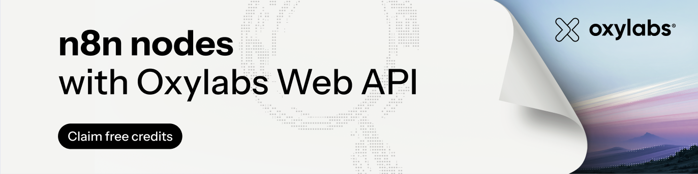

# n8n-nodes-oxylabs-web-api

This is an n8n community node for the [Oxylabs Web API](https://oxylabs.io). It lets your workflows and AI agents search the live web and read any page, including JavaScript-heavy and bot-protected ones, as Markdown, HTML, a screenshot or structured JSON.

[n8n](https://n8n.io/) is a [fair-code licensed](https://docs.n8n.io/sustainable-use-license/) workflow automation platform.

[Installation](#installation) ·
[Operations](#operations) ·
[Credentials](#credentials) ·
[Compatibility](#compatibility) ·
[Usage](#usage) ·
[Resources](#resources)

## Installation

Follow the [installation guide](https://docs.n8n.io/integrations/community-nodes/installation/) in the n8n community nodes documentation, and install the package `n8n-nodes-oxylabs-web-api`.

## Operations

| Resource | Operation | What it does |
|---|---|---|
| Search | Search the Web | Ranked organic results (title, outline, URL) for a query, optionally for a country |
| Scrape | Scrape a URL | Read one page as Markdown (default), HTML, a PNG screenshot (binary data), or the fields you describe as JSON |
| Scraper | Run | Run a dedicated scraper (Amazon, Google, Walmart, ChatGPT, YouTube and many more) with its own parameters, as content or parsed JSON |
| Scraper | Get Parameters | The JSON Schema of the parameters a scraper accepts |
| Request | Get Result | The result of a queued scrape, by its `request_id` |

The node can also be used as a tool by the n8n AI Agent.

## Credentials

1. In the [Oxylabs dashboard](https://dashboard.oxylabs.io), create a **Web API** instance, open it, and copy the API key shown at the top of the instance page.
2. In n8n, create an **Oxylabs Web API** credential and paste the key.

The key is sent as `Authorization: Bearer <key>`. **Test** checks it with a free call that lists the scrapers.

## Compatibility

Tested with n8n 2.x (local `npm run dev`). Requires n8n with `n8nNodesApiVersion` 1.

## Usage

### Examples

**Research agent.** Add an **AI Agent** node with a chat model, and attach **Oxylabs Web API** as a tool twice: once with *Search the Web*, once with *Scrape a URL*. Click the sparkle next to **Query** and **URL** to let the model fill them in. The agent can then search for sources and read the pages it picks.

**Read a list of pages.** Feed rows with a `url` column (for example from Google Sheets) into **Scrape a URL**, set **URL** to the expression `{{ $json.url }}` and **Format** to *Markdown*. Each row comes out with the page in its `markdown` field, ready for an LLM or a document store.

**Pull fields out of a page.** In **Scrape a URL**, choose *Structured Data (JSON)* and describe the fields, for example *the book titles and their prices*. The item's `json` field holds the result.

**Track Google results.** Start with a **Schedule Trigger**, then **Scraper > Run** with scraper `scrape/google/search`, **Parameters** `{"query": "best running shoes", "location": "US"}` and **Output** *Structured Data (JSON)*. Each run returns the parsed results page, which you can append to a sheet to watch rankings over time.

### Slow pages and queued scrapes

Every scrape is tried synchronously first. If it outlives the synchronous call, the node sends the same request to the API's queue and waits for it, checking every 5 seconds, for up to **Max Wait** (5 minutes by default). Scrapers marked *(queued only)* are always queued.

If the wait runs out, or **Wait for Queued Results** is off, the item carries a `request_id` and `state: "pending"`. Fetch it later with **Request > Get Result**.

### Structured data

- **Scrape a URL** with the *Structured Data (JSON)* format uses the AI parser. Describe the fields in plain words, or give a JSON Schema.
- **Scraper > Run** with *Structured Data (JSON)* uses the scraper's dedicated parser, which returns search results, products, sellers, hotels and the like in a fixed shape. Set **AI Fallback Prompt** to have the AI parser step in when the dedicated parser fails, returns nothing, or does not exist for that scraper. Choose the *AI* parser to skip the dedicated one.

Each output item says which parser answered in its `parser` field.

### Scraper parameters

**Parameters** is the scraper's own request body as JSON, for example `{"query": "wireless earbuds", "domain": "de"}` for `scrape/amazon/search`. Run **Scraper > Get Parameters** to see every key, its type and its allowed values.

### Errors

A wrong key, a spent quota (429 `QUOTA_EXCEEDED`) and invalid parameters fail at once with a message that says what to fix. Rate limits and transient server errors are retried twice with backoff. Faulted requests are not charged; quote the `request_id` in the error to Oxylabs support if one keeps failing.

## Resources

- [n8n community nodes documentation](https://docs.n8n.io/integrations/#community-nodes)
- [Oxylabs Web API remote MCP server](https://github.com/oxylabs/web-api-mcp), for agents that speak MCP: n8n's MCP Client Tool can connect to `https://mcp.oxylabs.io/web-api-mcp` with the same key
